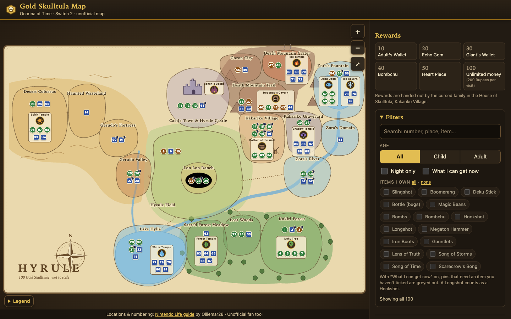

# Gold Skulltula Map: Ocarina of Time (Switch 2)

An unofficial, interactive map and checklist for all 100 Gold Skulltulas in *The Legend of Zelda: Ocarina of Time* on Switch 2.

**Live site: https://clrke.github.io/oot-skulltula-map/**

## Features

- An original, hand-drawn SVG map of Hyrule with a numbered pin for every Skulltula, grouped by region and dungeon.
- Pin colour and shape show child, adult or either; a moon badge marks night-only ones.
- Click a pin for a short hint, the items you need and a link to the full guide entry.
- A checklist synced with the map. Progress is saved in your browser, with export and import as a short code.
- A reward track (10 / 20 / 30 / 40 / 50 / 100) showing your next reward.
- Filters: child or adult, night only, hide collected, search, and "what I can get now" based on the items you tick.
- Deep links: `#12` opens Skulltula 12.
- Works offline after the first load, and on mobile.

## Credits and disclaimer

Locations and numbering come from the Nintendo Life guide [All Gold Skulltula Locations In Zelda: Ocarina Of Time (Switch 2)](https://www.nintendolife.com/guides/zelda-ocarina-of-time-gold-skulltula-locations-rewards-switch-2) by Olliemar28. The game does not number Skulltulas, so the numbers are the guide's own ordering. Hints are short paraphrases written for this site; each links back to the guide for the full entry and screenshots.

This is an unofficial fan project, not affiliated with or endorsed by Nintendo or Nintendo Life. The map is original artwork, not Nintendo's. Child/adult labels not stated by the guide are marked "inferred", and a few entries carry notes where the guide's own data looks inconsistent.

## Privacy

Your progress is stored only in your browser (localStorage). The live site uses Google Analytics (gtag.js) to count visits; nothing you tick is sent anywhere.

## Run locally

It is plain HTML, CSS and JavaScript with no build step. Serve the folder with any static server:

    python3 -m http.server 8000

then open http://localhost:8000/.

## Licence

Code: MIT (see `LICENSE`). Skulltula data and hints: credit the Nintendo Life guide as above.
